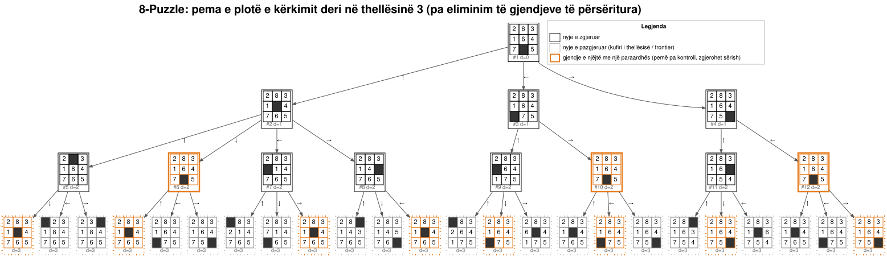
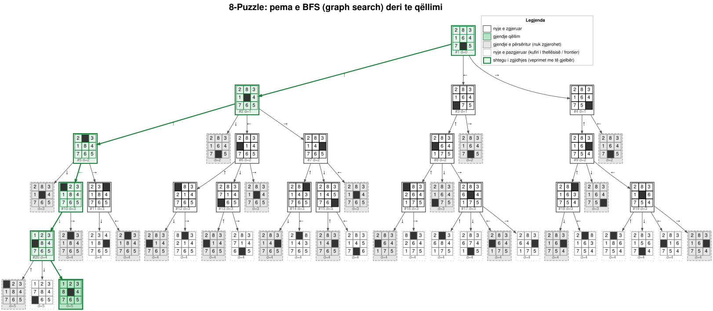
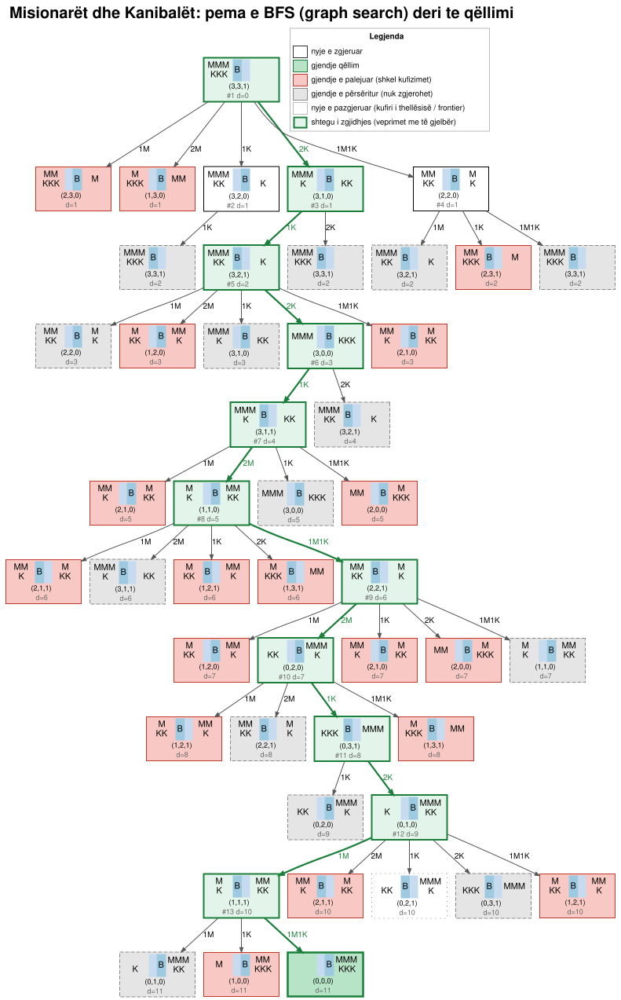
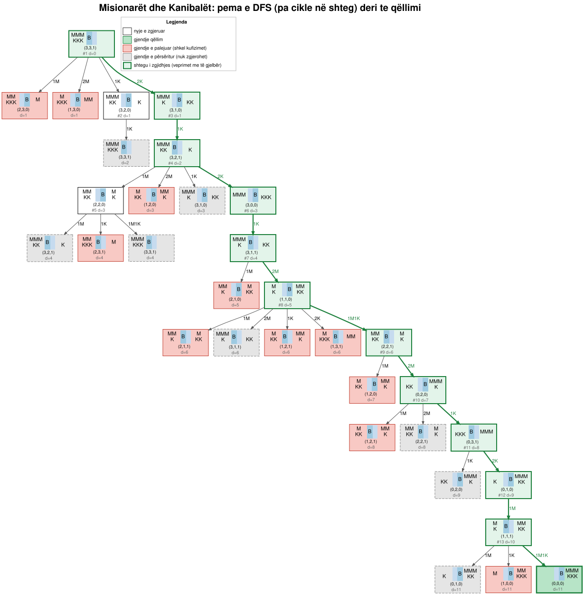
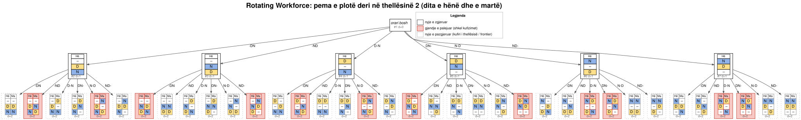
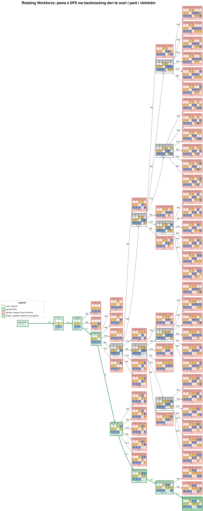

# Problemi 4: Pemët e kërkimit (8-Puzzle, Misionarët dhe Kanibalët, Rotating Workforce Scheduling)

> **Kërkesa:** Konstruktoni pemën e kërkimit (*search tree*) për 8-Puzzle, Missionaries and
> Cannibals dhe Rotating Workforce Scheduling.

Kodi: [`uninformed_search/trees/`](../uninformed_search/trees/) ·
Testet: [`tests/test_trees.py`](../tests/test_trees.py) ·
Figurat: [`docs/img/`](img/) (SVG + burimi Graphviz `.dot`) ·
Statistikat: [`results/04-search-trees.md`](../results/04-search-trees.md)

---

## 1. Pema e kërkimit: konceptet

Një problem kërkimi (sipas AIMA) jepet me: **gjendjen fillestare**, **veprimet** `ACTIONS(s)`,
**modelin e tranzicionit** `RESULT(s, a)`, **testin e qëllimit** dhe **koston e shtegut**.
*Hapësira e gjendjeve* është grafi i të gjitha gjendjeve; *pema e kërkimit* është struktura që
ndërton algoritmi kur zgjeron nyjet duke filluar nga rrënja. E njëjta gjendje mund të shfaqet në
shumë nyje të pemës (p.sh. kur një veprim zhbën veprimin e mëparshëm).

Çdo nyje e pemës ruan: gjendjen, prindin, veprimin që e krijoi dhe thellësinë. Programi
[`trees/core.py`](../uninformed_search/trees/core.py) ndërton pemën me BFS ose DFS dhe e
eksporton në Graphviz. Trajtimi i gjendjeve të përsëritura zgjidhet me parametrin `repeated`:

| `repeated` | Lloji i kërkimit | Kuptimi |
|---|---|---|
| `none` | *tree search* | asnjë kontroll; gjendjet e përsëritura zgjerohen sërish |
| `ancestors` | tree search pa cikle | nuk zgjerohet gjendja që gjendet te paraardhësit e saj |
| `explored` | *graph search* | nuk zgjerohet asnjë gjendje e parë më parë kudo në pemë |

Ngjyrat në figura: **të bardha**: nyje të zgjeruara (numri `#k` = radha e zgjerimit),
**të gjelbra**: shtegu i zgjidhjes dhe qëllimi; **të kuqe**: gjendje që shkelin kufizimet,
**gri me vija**: gjendje të përsëritura që nuk zgjerohen; **me pika**: nyje të gjeneruara që
nuk u zgjeruan (kufiri i thellësisë ose radha kur u gjet qëllimi), **kornizë portokalli**:
gjendje e njëjtë me një paraardhës në pemën pa kontroll. Testi i qëllimit bëhet kur nyja
gjenerohet.

## 2. 8-Puzzle

### 2.1 Formulimi

| Elementi | Përmbajtja |
|---|---|
| Gjendja | renditja e pllakave 1-8 dhe e vendit bosh në rrjetën 3×3 |
| Gjendja fillestare | `2 8 3 / 1 6 4 / 7 _ 5` (shembulli klasik i Nilsson) |
| Veprimet | lëviz vendin bosh `↑ ↓ ← →` (2-4 veprime sipas pozicionit) |
| Modeli i tranzicionit | vendi bosh shkëmben vendin me pllakën fqinje |
| Qëllimi | `1 2 3 / 8 _ 4 / 7 6 5` |
| Kostoja e shtegut | 1 për çdo lëvizje |

**Hapësira e gjendjeve:** `9! = 362 880` renditje të pllakave, por nga një gjendje e dhënë arrihen
vetëm gjysma, `9!/2 = 181 440` (AIMA, kap. 3.2). Programi e numëron këtë me një BFS mbi tërë
hapësirën duke filluar nga qëllimi: 181 440 gjendje, distanca maksimale nga qëllimi 30 lëvizje.
Faktori mesatar i degëzimit është rreth 2.67 (mesatarja e 2, 3 dhe 4 lëvizjeve sipas pozicionit
të vendit bosh); kur përjashtohet lëvizja që zhbën të fundit, bie në rreth 1.67.

### 2.2 Pema e plotë deri në thellësinë 3 (tree search)



Pema ka `1 + 3 + 8 + 24 = 36` nyje. 11 nyje (kornizë portokalli) janë thjesht kthim në gjendjen
e gjyshit (p.sh. `↑` pastaj `↓`): pema e kërkimit është shumë më e madhe se hapësira e
gjendjeve që përmban.

### 2.3 Pema e BFS deri te qëllimi (graph search)



BFS zgjeron 20 nyje, gjeneron 54 (19 të përsëritura) dhe gjen zgjidhjen optimale në
**thellësinë 5**: `↑ ↑ ← ↓ →`.

## 3. Misionarët dhe Kanibalët

### 3.1 Formulimi

| Elementi | Përmbajtja |
|---|---|
| Gjendja | `(m, k, b)`: misionarë dhe kanibalë në bregun e **majtë**, `b = 1` nëse barka është majtas |
| Gjendja fillestare | `(3, 3, 1)` |
| Veprimet | barka çon 1 ose 2 persona: `1M, 2M, 1K, 2K, 1M1K` |
| Modeli i tranzicionit | personat kalojnë në bregun tjetër bashkë me barkën |
| Kufizimi | në asnjë breg misionarët nuk janë më pak se kanibalët (nëse ka misionarë atje) |
| Qëllimi | `(0, 0, 0)` |
| Kostoja e shtegut | 1 për çdo kalim |

**Hapësira e gjendjeve:** `4 · 4 · 2 = 32` treshe, nga të cilat 20 plotësojnë kufizimin dhe
vetëm **16** janë të arritshme nga gjendja fillestare. Gjendjet që shkelin kufizimin gjenerohen
(për t'u parë në pemë) por nuk zgjerohen. Ky është backtracking-u në këtë problem.

### 3.2 Pema e BFS (graph search)



47 nyje: 13 të zgjeruara, 18 të palejuara, 14 të përsëritura. Zgjidhja optimale ka
**11 kalime**:

`2K → 1K ← 2K → 1K ← 2M → 1M1K ← 2M → 1K ← 2K → 1M ← 1M1K →`

### 3.3 Pema e DFS (pa cikle në shteg)



DFS i gjeneron pasardhësit një nga një dhe zbret menjëherë në secilin; me eliminimin e
gjendjeve që përsërisin një paraardhës gjen të njëjtën zgjidhje me 11 kalime me vetëm 33 nyje.
Pa këtë kontroll DFS do të futej në ciklin `1K, 1K, 1K, …` midis `(3,3,1)` dhe `(3,2,0)`
(shko-kthehu, sepse `1M` dhe `2M` janë të palejuara në fillim) dhe nuk do të mbaronte:
shembull konkret pse DFS nuk është e plotë në hapësira me cikle.

## 4. Rotating Workforce Scheduling (RWS)

### 4.1 Problemi

Në një orar rrotullues (ciklik) për `n` punonjës, orari është matricë `n × 7`: rreshti `i` është
java e punonjësit `i`; javën tjetër ai punon rreshtin `i + 1`, e kështu me radhë. I gjithë plani
lexohet si **një sekuencë ciklike** `rreshti 1, rreshti 2, …, rreshti n, rreshti 1, …` dhe të
gjithë punonjësit kanë të njëjtin orar, të zhvendosur për disa javë (drejtësi). Kufizimet tipike
(Musliu, Gärtner & Slany, 2002):

* **kërkesat ditore (temporal requirements):** sa punonjës duhen në secilin turn çdo ditë;
* gjatësia minimale/maksimale e **blloqeve të punës** dhe e **blloqeve të pushimit**;
* gjatësia minimale/maksimale e blloqeve të secilit **turn**;
* **sekuenca të ndaluara** turnesh (p.sh. turni i natës menjëherë para atij të ditës).

### 4.2 Instanca e përdorur (e vogël që pema të vizatohet)

| Parametri | Vlera |
|---|---|
| Punonjës | 3 (cikli = 3 javë = 21 ditë) |
| Turnet | `D` = ditë, `N` = natë, `-` = pushim |
| Kërkesat | çdo ditë 1 × D dhe 1 × N (pra çdo ditë pushon 1 punonjës) |
| Blloqe pune | 2-4 ditë radhazi |
| Blloqe pushimi | 1-2 ditë |
| Blloqe `D` / `N` | 1-3 / 2-3 ditë |
| Sekuencë e ndaluar | `N → D` |

### 4.3 Formulimi si problem kërkimi (kolonë pas kolone)

| Elementi | Përmbajtja |
|---|---|
| Gjendja | kolonat e para `d` të matricës (ditët e plotësuara, `0 ≤ d ≤ 7`) |
| Gjendja fillestare | matrica bosh |
| Veprimet | plotëso ditën `d` me një renditje të kërkesës së ditës, p.sh. `"DN-"` = punonjësi 1 → D, punonjësi 2 → N, punonjësi 3 pushon; kërkesa ditore plotësohet gjithmonë, `3!/(1!·1!·1!) = 6` veprime për nivel |
| Kontrolli (backtracking) | në çdo rresht: asnjë `N → D`, asnjë bllok më i gjatë se maksimumi, asnjë bllok i mbyllur më i shkurtër se minimumi; te `d = 7` kontrollohet e gjithë sekuenca ciklike |
| Qëllimi | `d = 7` dhe sekuenca ciklike plotëson të gjitha kufizimet |

Hapësira: pema e plotë ka `6^7 = 279 936` gjethe, ndërsa reprezentimi qelizë pas qelize (çdo
qelizë `D`, `N` ose `-`) do të kishte `3^21 ≈ 1.05 · 10^10` matrica. Futja e kërkesave ditore në
veprime e zvogëlon hapësirën 37 000 herë.

### 4.4 Pema e plotë deri në thellësinë 2



Nga 36 nyje në thellësinë 2, **12 shkelin kufizimet** që në ditën e dytë (p.sh. punonjësi me `N`
të hënën merr `D` të martën → `N → D`).

### 4.5 Pema e DFS me backtracking deri te orari i parë



DFS gjeneron 70 nyje (54 të palejuara) dhe gjen orarin në thellësinë 7. Shumë *dead ends*
shfaqen vetëm te dita e 7-të, kur kontrollohet edhe kalimi nga e diela e një rreshti te e hëna e
rreshtit tjetër (cikli).

Orari i gjetur (lexohet rresht pas rreshti, në mënyrë ciklike):

| Punonjësi | Hë | Ma | Më | En | Pr | Sh | Di |
|---|---|---|---|---|---|---|---|
| 1 | - | - | D | N | N | - | D |
| 2 | D | D | - | D | D | D | - |
| 3 | N | N | N | - | - | N | N |

Kontroll mbi sekuencën ciklike prej 21 ditësh: çdo ditë ka saktësisht 1 `D` dhe 1 `N`; blloqet e
punës janë `DNN`, `D|DD` (e diela e rreshtit 1 vazhdon te e hëna dhe e marta e rreshtit 2), `DDD`,
`NNN` dhe `NN`, me gjatësi 3, 3, 3, 3, 2; blloqet e pushimit kanë gjatësi 2, 1, 1, 1, 2 (blloku
`--` në fillim të rreshtit 1 vjen pas `NN` në fund të rreshtit 3); blloqet `N` kanë 2-3 ditë dhe
asnjë `N` nuk pasohet drejtpërdrejt nga `D`.

## 5. Ekzekutimi

```bash
# rigjenero të gjitha figurat (kërkon Graphviz: brew install graphviz)
python -m uninformed_search trees

# pa Graphviz: shtyp pemën në terminal
python -m uninformed_search trees --ascii mc_bfs_graph
python -m uninformed_search trees --ascii 8puzzle_bfs_graph
python -m uninformed_search trees --ascii rws_dfs
```

Pa Graphviz programi shkruan vetëm skedarët `.dot`, të cilët mund të hapen edhe online
(p.sh. në çdo shikues Graphviz).

## 6. Përfundime

* Pema e kërkimit mund të jetë shumë më e madhe se hapësira e gjendjeve (8-Puzzle: kthimet
  mbrapa; M&K: ciklet). Graph search (bashkësia `explored`) e eliminon këtë tepricë me kosto
  memorieje.
* Kufizimet e problemit (M&K: siguria e misionarëve; RWS: blloqet dhe sekuencat) krasisin pemën
  që në nivelet e para, i njëjti parim si backtracking te problemet 1-3.
* Formulimi ka rëndësi: te RWS kalimi nga "qelizë pas qelize" në "kolonë pas kolone" (kërkesat
  ditore brenda veprimeve) e zvogëlon hapësirën me katër rende madhësie.
